# Dim Factory

A desktop app that runs the AI coding tools you already have (Claude Code, Codex, Gemini, Grok, Muse) as one team:
one plans, one builds, others review and check each other's work, and it fixes what they find. Describe what you
want in plain words, or take full control of every step. Not sure which model suits your work? Build the same task
with two of them, compare the results and keep the one you prefer.

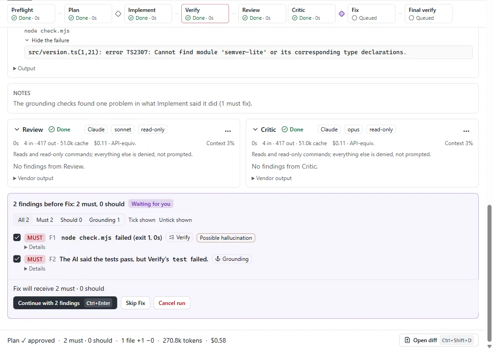

- **One pipeline, several models**: Clarify, Research, Plan, Implement, Verify, Review with Critic and Security side
  by side, Fix until green, Explain. Pick the vendor, model and effort per step, or use a profile.
- **Your tools, your logins**: Dim Factory drives the CLIs installed on your computer. No API keys, no proxy, and
  approvals they ask for come to you.
- **Checks you can trust**: tests and a page-load check before anything is called ready, a secret scanner and
  security review, and grounding checks that flag claims the evidence does not support ("tests pass" when none ran,
  packages that do not exist).
- **Guardrails you can check**: protected files, forbidden commands, chosen tools only and more, with a preset on by
  default. Each rule says what it stops and what it cannot, a project can only tighten your rules, a run will not start
  if a rule cannot hold, and you can test a rule for free. They are not a security boundary against deliberately
  malicious code, and the app says so.
- **Context health**: how full each model's context is, when it compacts, what (which skill, MCP server or memory
  file) makes every step heavier, and loops it gets stuck in.
- **Made for beginners too**: Easy mode asks "What do you want to make?", asks a few plain questions, and builds a
  website, app, game, document, data report, research memo or checklist that opens and works, with costs explained.
  **It's not working** finds the cause before fixing it, and **Try it for me** presses through the result for you.
- **Preview and share**: open results in a sandboxed preview, play-test games automatically, and get copy-only deploy
  steps or a drag-and-drop upload file. Dim Factory never deploys for you or stores your tokens.
- **Head to head**: build one task twice, with two vendors or two models, each in its own copy of your folder. Compare
  the checks, the cost and the changes file by file, with the builders' names hidden until you pick if you like, then
  keep one result (with an undo) or neither. A prompt check says, before anything is spent, when a task is too open.
- **Rematch and Scoreboard**: replay a task you already finished against another model, from where that run began,
  and pick the result you prefer; nothing is applied. When a price update adds a model, try it on a few past tasks
  through the queue. The Scoreboard on the Plops page shows what your picks and the checks say per kind of task, and
  says when there are too few matches to tell.
- **Make two and pick** (Easy mode): have a new project, or a change to one, made twice, each version in its own copy.
  Open both and keep the one you like. Your project stays as it is until you choose.
- **Unattended work**: a task queue with schedules, budgets, stop rules, quality gates and project memory.

## Who it is for

- **Beginners and non-developers.** You do not need to know what you need. Easy mode picks the right kind of project,
  asks one plain question when something needs a server or a paid service (and says what it costs and which hosts
  are free), marks the facts only you can fill in instead of inventing them, and explains how to open, change and
  share what it made. If you cannot decide, have it made twice and keep the version you like.
- **Developers.** Several models checking each other's work, every pass's diff, Verify and Fix loops, session reuse,
  per-pass extensions (MCP servers and skills), and a run you can always inspect, stop, revert or re-run from Fix.
  Head to head and Rematch show how two vendors or models do on your own tasks, and the Scoreboard keeps count.
- **Unattended work.** Queue tasks per folder, run them overnight within budgets, and get a daily report.

## Screenshots

|                                                                                                                                                    |                                                                                                                                                        |
| -------------------------------------------------------------------------------------------------------------------------------------------------- | ------------------------------------------------------------------------------------------------------------------------------------------------------ |
| 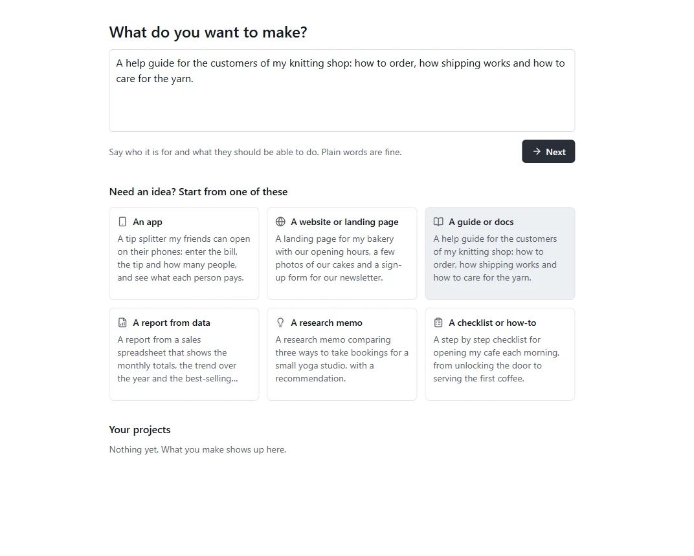                                     | 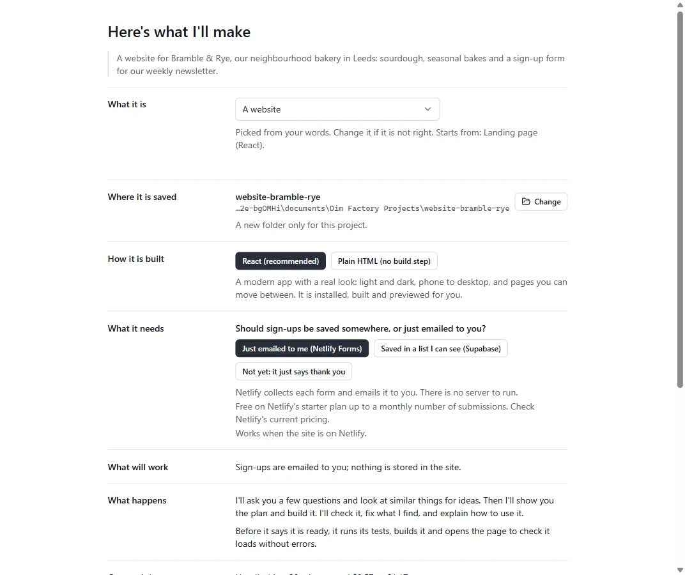 |
| **Easy: start from an idea.** Describe it in a sentence, or start from an example.                                                                 | **Here's what I'll make.** How it is built, what it needs (with costs and free hosting), and what will work.                                           |
| 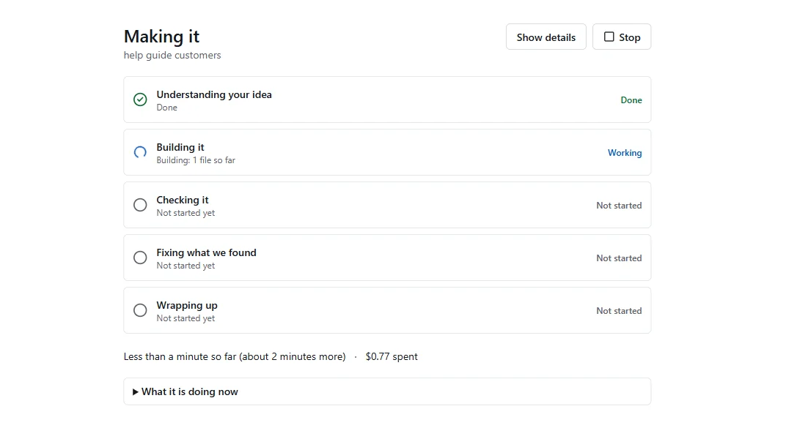                                                                    | 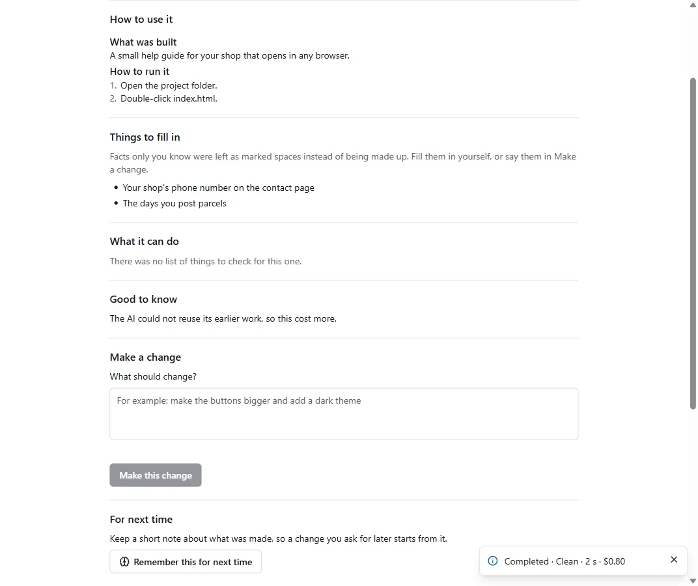                                                 |
| **Progress in plain words.** Five milestones instead of passes and diffs.                                                                          | **Done.** How to use it, what to fill in, make a change, undo.                                                                                         |
| 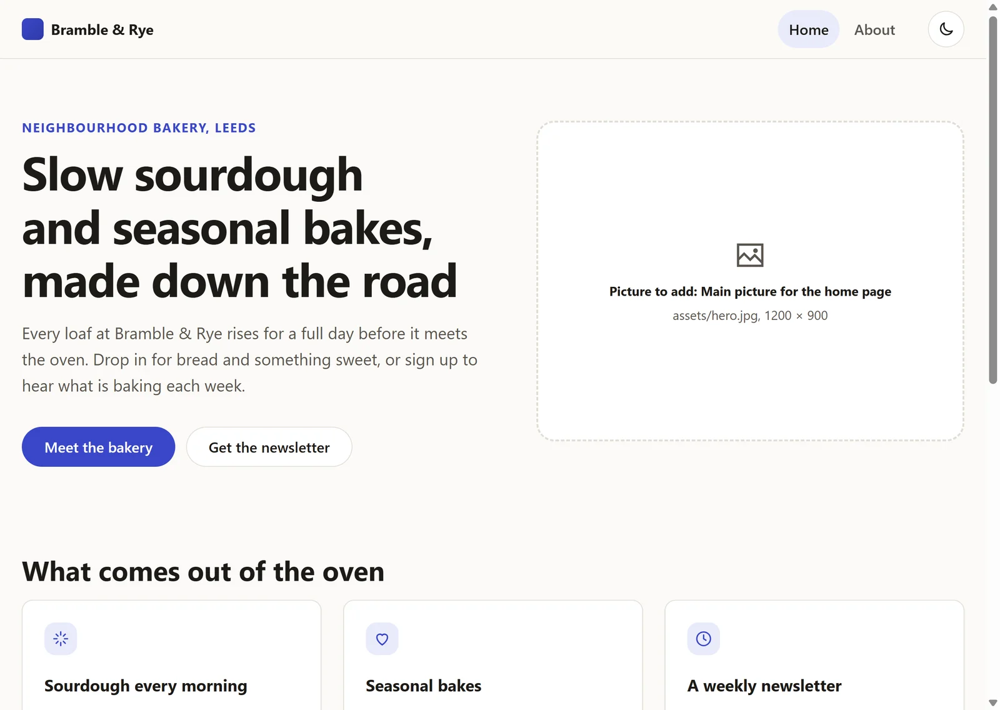 | 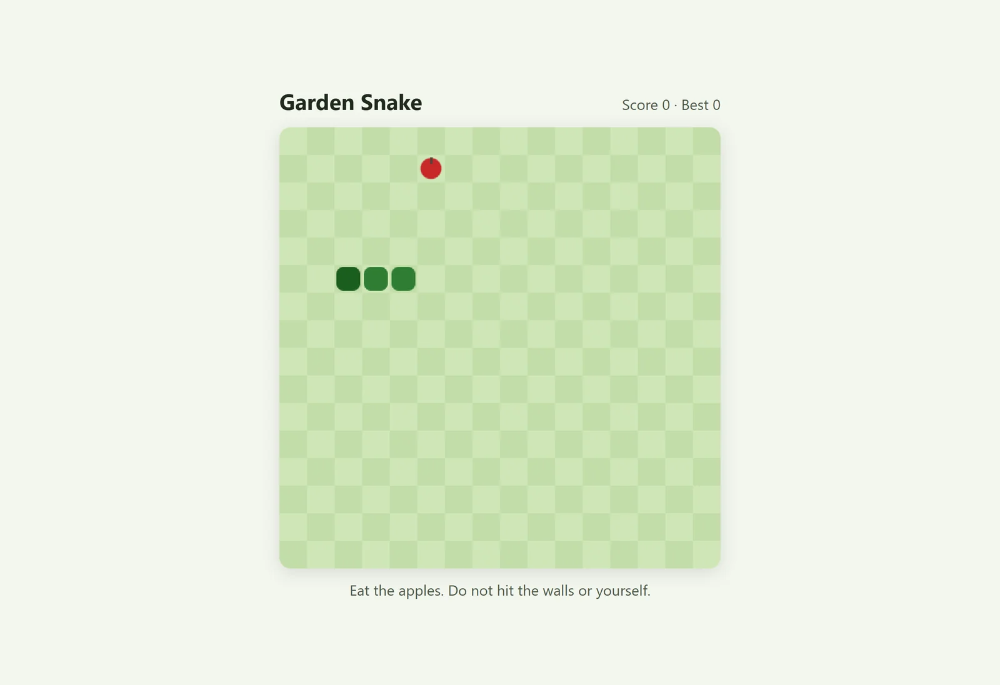                                                                                |
| **A real look by default.** Websites and apps start from React with a theme, light and dark, and marked picture slots.                             | **Games that are checked.** Light web games are play-tested automatically before they are called done.                                                 |
| 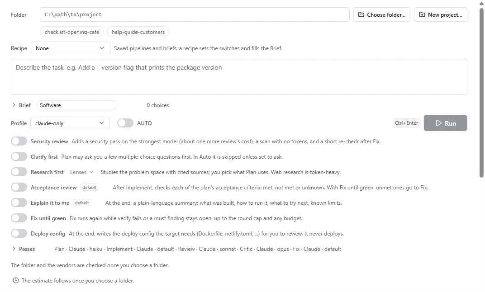                                       | 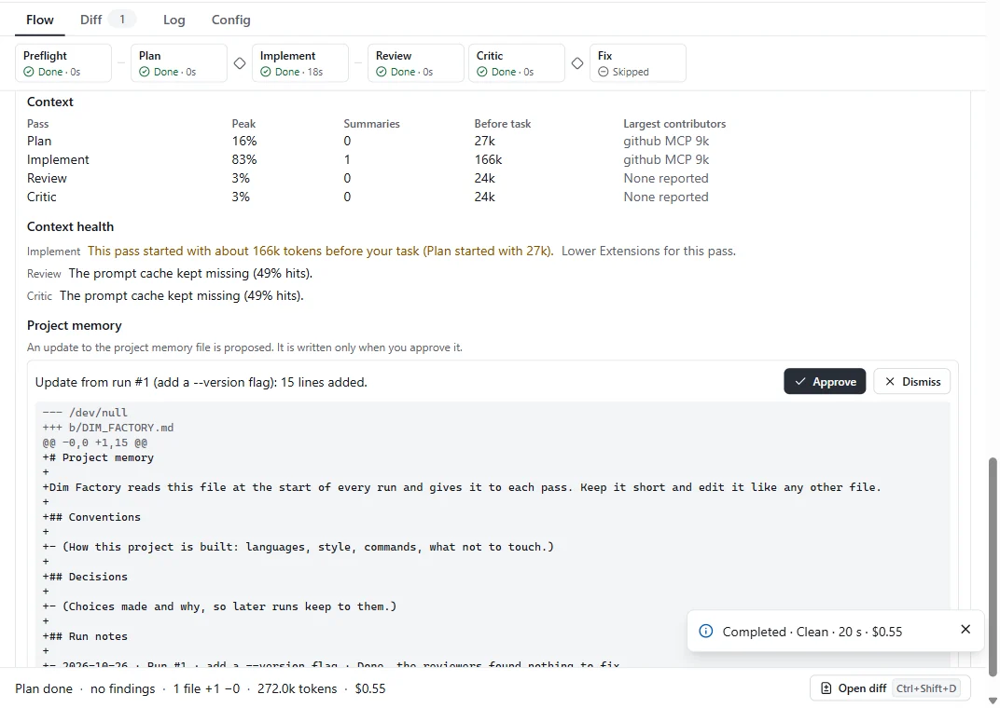                       |
| **Full control.** Recipes, the Brief, profiles and every optional step in one place.                                                               | **Context health.** Peak context, summaries, what makes each step heavier, and what to do about it.                                                    |

## Plops

Every AI gets a Plop. A Plop grows with the tokens its model used over the last 7 or 30 days, so a row of them reads
as a usage comparison at a glance, with the real numbers underneath. It snacks while it is in use and right before it
grows, smokes when it works hard, falls asleep when idle, melts into a puddle when it has not been used lately, and
shows oil for failures and steam when it hits a limit.

|                                                                                                              |                                                                                           |
| ------------------------------------------------------------------------------------------------------------ | ----------------------------------------------------------------------------------------- |
| 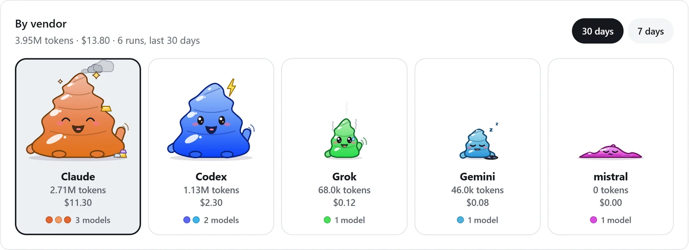 | 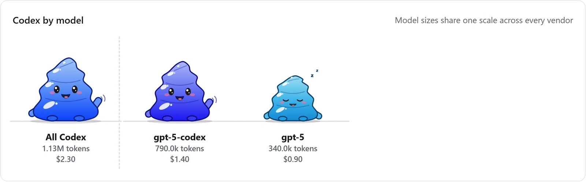 |
| **By vendor.** Size, mood and numbers at a glance.                                                           | **By model.** Click a vendor to compare its models.                                       |
| 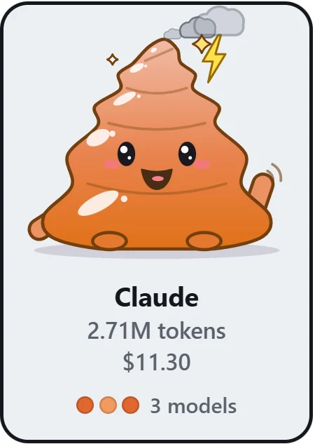               | 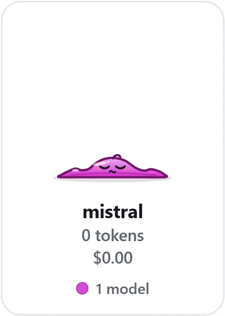                        |
| **Snacks before it grows.**                                                                                  | **A puddle** when a model was used before but not lately.                                 |

Screenshots use sample data.

## Status

Version 1.0.0 is being prepared. It has not been released yet, and it has only been run for real on Windows so far:
CI on macOS and Linux, and installing on each system, come before the first release. Builds will be unsigned at first.
[docs/RELEASING.md](docs/RELEASING.md) covers how releases are built.

## Installing

Download the file for your system from the [Releases page](https://github.com/danielmcleod/dimfactory/releases), plus `SHA256SUMS` if you want to check the
download. The builds are not signed with a paid certificate yet, so Windows and macOS warn you the first time. The
steps below get past that once.

### Windows

1. Download `dim-factory-setup-<version>.exe`.
2. Optional: check the download. In PowerShell, in your Downloads folder:

   ```powershell
   Get-FileHash .\dim-factory-setup-<version>.exe -Algorithm SHA256
   ```

   The hash must match the line for that file in `SHA256SUMS` (PowerShell prints it in capital letters; that is fine).

3. Run the installer. If Windows shows "Windows protected your PC", click **More info**, then **Run anyway**. The
   warning appears because the installer is unsigned, not because anything is wrong with it.

### macOS

1. Download the dmg for your Mac: `dim-factory-<version>-arm64.dmg` for Apple silicon (M1 and later), or
   `dim-factory-<version>-x64.dmg` for Intel.
2. Optional: check the download. In Terminal, in your Downloads folder:

   ```sh
   shasum -a 256 --check --ignore-missing SHA256SUMS
   ```

3. Open the dmg and drag Dim Factory to Applications.
4. Open Dim Factory. The first launch is blocked because the app is not notarized by Apple: click **Done**.
5. Go to System Settings › Privacy & Security, click **Open Anyway** next to the message about Dim Factory, and enter
   your password. You only do this once.

Homebrew's main cask list does not accept apps that are not signed and notarized, so there is no
`brew install --cask` for Dim Factory yet.

### Linux

Ubuntu and Debian, with the deb (recommended; it also installs the AppArmor profile Chromium's sandbox needs on
Ubuntu 24.04 and later):

```sh
sudo apt install ./dim-factory_<version>_amd64.deb
```

Other distributions, with the AppImage (it needs FUSE 2):

```sh
chmod +x dim-factory-<version>-x86_64.AppImage
./dim-factory-<version>-x86_64.AppImage
```

To check the downloads, put them in one folder with `SHA256SUMS` and run `sha256sum -c SHA256SUMS` (add
`--ignore-missing` if you downloaded only some of the files).

## Prerequisites

| Item         | Install                                    | Notes                                                                          |
| ------------ | ------------------------------------------ | ------------------------------------------------------------------------------ |
| Node ≥ 24.15 | [nodejs.org](https://nodejs.org) v24       | `.nvmrc` tracks 24                                                             |
| pnpm 10      | `corepack enable`                          | pinned by `packageManager` in package.json                                     |
| Git ≥ 2.35.2 | `winget install --id Git.Git -e` (Windows) | for git 2.17 compatibility runs, point `DIM_FACTORY_TEST_GIT` at MinGit 2.17.1 |
| Vendor CLIs  | standalone Claude Code / Codex installs    | only needed to **record** fixtures; tests and CI never call a real vendor      |

Record fixtures with isolated vendor profiles (`CLAUDE_CONFIG_DIR=~/.claude-fixtures`,
`CODEX_HOME=~/.codex-fixtures`), so a recording never picks up your own settings, sessions or credentials, and with
the standalone CLI installs, never with the binaries bundled in the desktop apps.

## Getting started

```sh
pnpm install
pnpm test
```

## Commands

| Command                                 | What it does                                                                                                       |
| --------------------------------------- | ------------------------------------------------------------------------------------------------------------------ |
| `pnpm dev`                              | run the app with hot reload (electron-vite)                                                                        |
| `pnpm build` / `pnpm start`             | build to `out/` / run the built app                                                                                |
| `pnpm lint`                             | ESLint (type-aware rules and layer import boundaries)                                                              |
| `pnpm format` / `pnpm format:check`     | Prettier                                                                                                           |
| `pnpm typecheck`                        | `tsc` for the node, web, test and e2e projects                                                                     |
| `pnpm test`                             | unit tests (Vitest project `unit`)                                                                                 |
| `pnpm test:int`                         | integration tests (real spawns against the fake CLI)                                                               |
| `pnpm test:renderer`                    | renderer tests (happy-dom + Testing Library)                                                                       |
| `pnpm e2e` / `pnpm e2e:smoke`           | build, then Playwright E2E against the app with fake vendor CLIs (all / the `@smoke` subset)                       |
| `pnpm package:dir` / `pnpm package`     | unpacked app in `dist/` / installers (electron-builder)                                                            |
| `pnpm smoke:packaged`                   | launch the unpacked app with `--smoke-test` and an isolated home                                                   |
| `node scripts/release.mjs build ...`    | a release build of this OS's installers (`--help`; unsigned unless the signing secrets are set; docs/RELEASING.md) |
| `pnpm cli <command>`                    | dev CLI `dimf` (alias `dim-factory`): `run`, `resume`, `show`, `runs`, `probe`, `preflight`, `config`, `doctor`    |
| `pnpm check:brand` / `pnpm brand:sync`  | the former-name check (part of `pnpm lint`) / write `src/shared/brand.ts` into the packaging files                 |
| `pnpm fake-cli`                         | build the fake `claude`/`codex`/`gemini` launchers into `tests/.bin/<platform>/` (tests do this automatically)     |
| `pnpm record:raw --bin <exe> ...`       | raw fixture recorder, `scripts/record-fixture.mjs` (`--help` for options)                                          |
| `pnpm fixture:script <recording.jsonl>` | turn a recording into an editable fake-CLI script                                                                  |

## Tests and fixtures

- `tests/fake-cli/fake-cli.mjs`: a scriptable fake vendor CLI that replays hand-written scripts or raw
  recordings over stdio. The op reference is in its header. It launches as `node <entry>`, through an npm-style
  `.cmd` shim (Windows) or a `#!/usr/bin/env node` copy (macOS/Linux).
- `tests/fixtures/<vendor>/<route>/<ID>-<slug>/recording.jsonl`: synthesized recordings (header, `{t,dir,line}`
  frames, exit), each marked `"synthesized": true`. `tests/unit/fixtures-redaction.test.ts` fails on any email, user
  path or token, and `tests/unit/fixtures-synthesized.test.ts` on a fixture that is not synthesized or carries
  real-account data.
- `tests/fixtures/sandboxes/`: tiny projects (`ts-small`, `py-small`, `plain-folder`) to copy into a temp dir and
  run against.

Recording a fixture (stdin frames may contain `{"$wait": {...}}` pacing directives):

```sh
pnpm record:raw --bin <path/to/claude> --arg -p --arg --input-format --arg stream-json \
  --cwd <copy of a sandbox> --out tests/fixtures/claude/stdio/C05-initialize \
  --vendor claude --route stdio --id C05 --slug initialize --stdin frames.jsonl --timing off
```

## License

MIT, see [LICENSE](LICENSE). The third-party pieces Dim Factory ships or copies into projects, and their licences, are
listed in [THIRD_PARTY_NOTICES.md](THIRD_PARTY_NOTICES.md).
